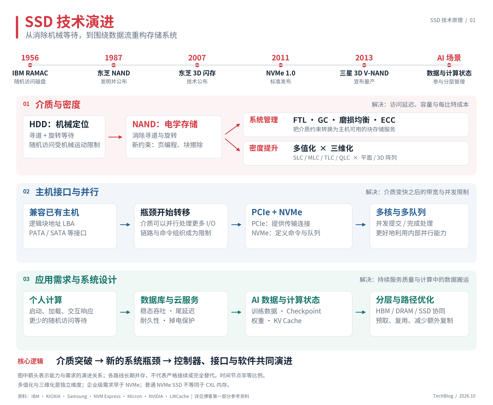
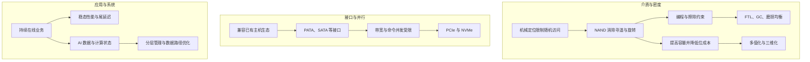

# 第一部分｜技术演进：SSD 的设计是如何被需求推动的？

> 《从 NAND 到存储系统：SSD 的技术原理、架构与演进》系列 · 第一部分  
> 更新：2026-10-10 · [返回专题](README.md) · [完整大纲](outline.md)

把电脑里的机械硬盘换成 SSD，最直接的感受往往是启动更快、软件打开更快，许多原本需要等待的操作变得流畅。如果只看外部接口，这种变化似乎很简单：两种设备都接收读写请求，都保存文件，只是 SSD 更快。

打开设备，差异却远不止存储介质。机械硬盘需要控制磁头和盘片，SSD 则需要协调大量 NAND 存储单元，处理地址转换、数据搬迁、错误纠正与介质磨损。主机发出的一次“覆盖写”，在 SSD 内部可能变成写入新位置、修改映射，并在稍后触发一次垃圾回收。

理解这些设计，最好先追问它们为什么出现。本文讨论以 **NAND Flash 为介质的 SSD**，沿着三个问题展开：怎样降低访问延迟，怎样降低每比特成本，以及怎样让应用充分利用设备能力。

[查看 SVG 矢量图](assets/ssd-evolution.svg)

## 1. HDD：容量可以增长，机械等待却很难消失

1956 年，IBM 的 RAMAC 系统将随机访问磁盘带入商业计算。磁盘让计算机能够定位并访问所需记录，而不必按照磁带的存储顺序一路扫描。随着数据库、文件系统和在线业务发展，这种随机访问能力越来越重要。[1]

但磁盘的“随机访问”仍然需要机械运动。读取一个不在缓存中的数据块时，磁头需要移动到目标磁道，再等待目标扇区旋转到磁头下方，最后才能传输数据。对一次普通磁盘访问，可以用下面的简化模型理解其耗时：

$$
T_{\mathrm{IO}} \approx T_{\mathrm{queue}} + T_{\mathrm{seek}} + T_{\mathrm{rotation}} + T_{\mathrm{transfer}}
$$

这里省略了控制器处理等开销。模型的关键在于：**小块随机访问时，定位数据的时间可能远大于传输数据的时间。**

以 7200 RPM 为例，一圈旋转时间为：

$$
T_{\mathrm{rev}}=\frac{60}{7200}\ \mathrm{s}\approx8.33\ \mathrm{ms}
$$

如果目标扇区相位均匀分布、暂不考虑请求重排，平均旋转等待约为半圈，即 4.17 ms。这还没有计入寻道。该数值是基于转速的教学计算，并不是某款硬盘的实测延迟。

这解释了 HDD 顺序读写与随机读写之间的巨大差异：连续传输可以摊薄定位成本，频繁跳转则不断付出机械等待。提高记录密度能够增加容量、改善顺序传输速度，却不能按同样比例缩短寻道和旋转时间。

软件因此会尽量合并请求、顺序追加、缓存热点。多块磁盘也能提供更高的聚合并发，但代价是增加设备、功耗与系统复杂度。随着业务需要越来越多的小块随机访问，消除机械定位成为重要的技术方向。

## 2. NAND：消除了机械运动，也带来了新的介质约束

NAND Flash 并不是在 SSD 普及时才出现的。东芝——也就是今天铠侠相关业务的前身——于 1987 年发明并公布 NAND Flash，1991 年将 4 Mbit NAND 产品商业化。其早期市场包括存储卡和便携设备；非易失、小型化等特点使它适合保存照片、音乐和移动设备数据。[2]

NAND 通过存储单元的电学状态保存信息，访问数据不需要移动磁头。因此，它消除了 HDD 的寻道和旋转等待。但“没有机械运动”不等于“可以像 DRAM 一样任意修改”。

对于 SSD 设计，最重要的约束是：NAND 以页为主要读取和编程组织单位，以更大的块为擦除单位；已编程区域不能被当成普通内存任意原地改写，擦除与编程还会逐步消耗介质寿命。具体器件可能支持部分页操作或其他模式，但不会因此消除这些基本约束。[3][4]

假设应用要更新一段已经保存的数据，直接把原位置擦除再写入会遇到一个问题：同一个擦除块中，还可能有许多不需要修改的有效数据。为了保留它们，设备必须先搬走这些数据，才能擦除整个块。

**主机希望更新一个小逻辑块，介质却要求以更大粒度回收空间。** 两种粒度之间的矛盾，成为后面 FTL、垃圾回收和写放大问题的起点。

| 主机希望得到的能力 | NAND 带来的约束 | SSD 需要提供的机制 |
| --- | --- | --- |
| 同一个地址可以反复写入 | 不能任意原地覆盖已编程数据 | 地址映射、异地更新 |
| 删除或更新后空间可以继续使用 | 擦除粒度大于普通更新粒度 | 有效数据搬迁、垃圾回收 |
| 热点地址长期反复写入 | 擦除与编程寿命有限 | 磨损均衡 |
| 读回的数据保持正确 | 磨损、干扰等因素可能引入错误 | ECC、坏块管理等 |

这里的“约束”不意味着 NAND 不适合存储。它意味着设备需要用控制器和算法，将介质的工作方式转换成主机可以使用的存储服务。[3]

## 3. 从芯片到 SSD：先让闪存融入已有的计算机

NAND 只负责提供存储能力，完整的 SSD 还需要接收主机命令、组织并行访问、管理数据位置，并在错误和掉电等条件下维持设备行为。

一个重要的工程选择是：继续向主机提供熟悉的**逻辑块地址**，即 LBA（Logical Block Address）。主机可以请求读写某个逻辑块，无须知道数据最终落在哪个 NAND Die、Block 或 Page 上。

这项选择使 SSD 能够接入已有的操作系统、文件系统和存储软件。铠侠的历史资料记录了 2001 年采用 SLC NAND 的 PATA SSD，以及 2007 年采用 MLC NAND 的 SATA SSD。[2] 因此，不能把 SSD 的出现归结为 SATA 或 NVMe 某一个接口的诞生；闪存存储设备与接口标准是在相互适配中发展的。

逻辑块接口背后，FTL（Flash Translation Layer，闪存转换层）维护逻辑地址与物理位置之间的关系。一次覆盖写可以采用下面的方式完成：

1. 主机要求更新某个 LBA。
2. SSD 将新数据写到新的可用物理位置。
3. 映射关系切换到新位置，旧数据成为无效数据。
4. 后台在适当时机搬迁仍有效的数据，并擦除可回收的块。[4]

这是机制示意，省略了缓存、编程失败处理和映射持久化等细节。

对主机而言，同一个地址的内容改变了；对介质而言，数据位置发生了变化。兼容性由此得以保留，但内部也增加了主机难以直接观察的工作。以后看到 SSD 在持续写入后掉速、满盘时延迟增加，就需要沿着这些内部工作寻找原因。

## 4. 密度演进：每个单元存更多位，在单位面积上放更多单元

消除机械等待解决了性能问题，SSD 能否广泛使用，还取决于容量和成本。NAND 的密度提升主要沿着两个相互独立的方向展开。

### 4.1 多值化：提高每个 Cell 的信息量

NAND 利用不同阈值电压状态区分数据。每个单元保存的位数增加，就需要区分更多状态。[5]

| 常用名称 | 每个 Cell 的位数 | 需要区分的状态数 |
| --- | ---: | ---: |
| SLC | 1 | 2 |
| MLC，通常特指 2-bit MLC | 2 | 4 |
| TLC | 3 | 8 |
| QLC | 4 | 16 |

从 TLC 变为 QLC，在单元数量相同的理想条件下，原始位容量增加的是三分之一；状态数量却从 8 增加到 16。也就是说，容量提升要求设备更精细地区分电压状态。

状态之间的间隔更窄，会增加编程控制和读取判决的难度，影响性能与耐久性。因此，多值化增加了控制器纠错、管理和调度的压力。它也不意味着某一代 QLC 整盘必然比任意 TLC 整盘慢：制程、并行规模、缓存策略和负载都会影响结果。[5]

### 4.2 三维化：提高单位面积上的单元数量

平面 NAND 通过缩小器件来提高密度，但持续缩小会遇到单元间干扰等问题。3D NAND 将存储阵列向垂直方向扩展，为增加单元数量提供另一条路径。

东芝于 2007 年公布 3D 闪存技术；三星于 2013 年宣布量产 24 层 3D V-NAND。这是“技术公布”与“量产产品”两个不同类型的节点，不应写成同一事件。[2][6]

**3D 与 TLC/QLC 描述的是两个维度**：前者描述阵列的空间结构，后者描述每个单元保存多少位。因此，一款 NAND 可以同时是 3D NAND 和 TLC NAND。芯片内部的多层存储阵列，也应与封装中堆叠多个 Die 区分开来。

这些变化增加了可制造的存储密度，但不会自动带来同等比例的整盘性能提升。单位容量需要的芯片数量、可用并行度、控制器带宽与介质操作耗时，仍然共同决定最终表现。

## 5. 接口演进：从兼容磁盘生态，到面向闪存并行能力设计

SATA SSD 的重要价值之一，是让用户能够在已有平台上使用闪存。随着 SSD 内部多个通道和 Die 并行工作，限制逐渐显现：即使介质还能处理更多请求，主机接口与命令组织方式也可能先成为瓶颈。

SATA 6 Gb/s 规定的是链路传输速率，并不代表应用可以得到 6 GB/s。协议、编码等开销还会进一步减少可用于用户数据的有效带宽。[7] 除了带宽，传统 AHCI/SATA 路径的命令组织方式也限制了扩展：常见比较中的单端口命令队列最多有 32 个命令槽位。[8]

NVMe 1.0 于 **2011 年 3 月 1 日**发布，其设计面向非易失性存储与多核系统。[9] 在常见的本地 NVMe SSD 中，PCIe 提供传输连接，NVMe 定义主机与控制器之间的命令、队列和完成通知机制。两者分属不同层次。

NVMe 使用提交队列和完成队列，并允许多组 I/O 队列并行工作。主机可以让不同 CPU 核心使用不同队列，减少争用；控制器则能够接收更多在途请求，再将它们调度到内部资源。实际队列数量与深度仍取决于设备和驱动，不能把规范上限直接当成产品能力。[10]

| 变化 | 解决的问题 | 仍然存在的限制 |
| --- | --- | --- |
| 使用 PCIe 传输 | 提供可扩展的链路带宽 | 控制器和 NAND 吞吐仍有上限 |
| 支持多组 I/O 队列 | 改善多核并发提交与完成处理 | 队列过深仍会增加排队 |
| 面向非易失存储设计命令接口 | 降低和组织主机交互开销 | 不会消除 NAND 编程、擦除和 GC |

这次演进说明：**介质变快之后，需要重新检查整条 I/O 路径。** NVMe 能减少接口和并发组织方面的限制，却不能使一次 NAND 读取变成内存访问，也不会让后台垃圾回收消失。

企业存储还存在 SAS SSD 等路线，NVMe 也可以通过 NVMe over Fabrics 扩展到网络存储。本文聚焦本地 SATA 到 PCIe/NVMe 的主要问题变化，不将它视为覆盖所有产品的唯一时间线。

## 6. 数据中心：从峰值速度，转向持续负载下的可预测性

企业级需求并不是 NVMe 之后才出现的。数据库与云服务在不同接口时代都需要可靠性、耐久性和稳定性能，只是随着部署规模扩大，这些要求更加突出。[2]

一个空盘上的短时顺序写结果，不能代表设备长期承受混合读写时的表现。随着写入持续，SSD 需要不断回收空间；如果有效数据分散在很多块中，搬迁工作就会与前台请求竞争资源。

预留空间（Over-Provisioning，OP）为这些后台工作提供调度余地。美光的技术资料以消费级和数据中心 SSD 为例，说明更多预留空间可以为有效数据搬迁提供更多选择，从而改善垃圾回收效率。[4]

对系统设计者来说，这意味着评估标准需要变化：既看 IOPS 和带宽，也看稳态表现、尾延迟、写入寿命和掉电保护。这里的变化来自应用需要怎样的服务，而不能只归因于接口升级。

## 7. AI 场景：SSD 开始保存需要回到计算路径的数据

AI 带来的变化，可以从数据的使用方式理解。训练数据和 Checkpoint 延续了持久化存储的需求；权重卸载、KV Cache 分层等方案，则让更多计算状态有机会在内存和存储之间迁移。

这些负载不能统一归纳为“大块顺序 I/O”。下面是用于分析系统的负载划分，而不是所有实现都满足的固定模式：

| 数据类型 | 可能出现的访问行为 | 需要优先分析的问题 |
| --- | --- | --- |
| 训练数据 | 分片读取、随机抽样、预取 | 数据准备是否让计算等待 |
| Checkpoint | 阶段性集中写入、恢复时读取 | 保存窗口、恢复耗时、持久化 |
| 模型权重 | 加载时读取，卸载方案中可能反复搬运 | 工作集大小、带宽与复用 |
| KV Cache | 按请求或数据块保存、复用与回迁 | 命中率、回迁延迟、粒度 |

LMCache 的本地存储后端提供了一个具体例子：它可以将 KV Cache 保存到本地磁盘，并支持预取到 CPU 内存。[11] SSD 在这种设计中承担的是计算状态的容量层；真正使用这些状态之前，系统仍要完成必要的数据搬运。

另一个方向是优化搬运路径。NVIDIA GPUDirect Storage 在受支持的配置中允许存储与 GPU 内存之间直接进行 DMA 传输，减少经由 CPU 内存中转缓冲区的额外复制。[12] 它改善的是数据路径，并不消除存储设备本身的访问延迟；具体收益还取决于拓扑、软件栈和访问方式。

由此可以得到一个系统设计上的推论：**SSD 能否帮助 AI 应用，取决于容量收益能否覆盖新增的数据访问与迁移成本。** 如果复用充分、预取有效，数据可能在被需要之前到达；如果访问无法预测且直接阻塞计算，即使 SSD 的峰值带宽很高，也未必改善端到端时延。

这些问题将在第九部分展开。此处需要保留的边界是：SSD 可以参与分层内存与缓存管理，但普通 NVMe SSD 依然是通过 I/O 访问的存储设备，不等同于可由 CPU 直接按普通内存方式访问的 CXL 内存设备。

## 8. 把历史串起来：三条演进线，共同塑造 SSD

下面的图按问题组织因果关系，不表示各项技术严格依次出现，也不表示后一项完全替代前一项。

沿着这三条线，可以重新理解后面章节中的技术：FTL 连接逻辑地址与介质位置；GC 解决异地更新后的空间再利用；纠错与磨损管理维持数据可靠性；NVMe 改善主机与设备之间的并行交互；应用感知的数据布局与预取，则试图让设备能力更好地服务实际负载。

它们分别回应不同层次的约束，也会互相影响。例如，提高存储密度可能增加介质管理难度；增加主机并发可能提高吞吐，也可能加重排队；减少前台等待的后台搬迁，又可能增加写入量。理解 SSD，最终要把这些取舍放回同一个系统里。

下一部分从这些取舍的物理起点展开：**一个 NAND Cell 如何保存数据，为什么读、编程、擦除具有不同粒度，以及这些差异如何传导到整盘行为。**

## 参考资料

以下资料用于核实历史节点与机制。厂商历史页面中的技术公布、产品商业化和量产属于不同事件；本文未将它们视作同一时间点。访问日期：2026-10-10。

1. IBM：[RAMAC](https://www.ibm.com/history/ramac)。随机访问磁盘的历史背景。
2. KIOXIA：[Technology Development History](https://www.kioxia.com/en-jp/rd/technology/history.html)。1987 年 NAND、1991 年商业化，以及 PATA/SATA SSD 和 3D NAND 节点。
3. Micron：[What is an SSD?](https://my.micron.com/about/micron-glossary/solid-state-drives)。控制器、磨损均衡、ECC 和垃圾回收概述。
4. Micron：[Client vs. Data Center SSDs](https://www.micron.com/content/dam/micron/global/public/products/technical-marketing-brief/client-vs-enterprise-performance-use-cases-tech-brief.pdf)。垃圾回收、有效页迁移和预留空间。
5. KIOXIA：[What is Multi-level Cell Technology Realizing Larger Capacity Flash Memory?](https://www.kioxia.com/en-jp/rd/technology/multi-level-cell.html)。每单元位数、阈值状态与性能/耐久性取舍。
6. Samsung：[Samsung Starts Mass Producing Industry’s First 3D Vertical NAND Flash](https://news.samsung.com/global/samsung-starts-mass-producing-industrys-first-3d-vertical-nand-flash)，2013 年。3D V-NAND 量产节点。
7. SATA-IO：[SATA Naming Guidelines](https://sata-io.org/developers/sata-naming-guidelines)。SATA 6 Gb/s 命名与链路速率。
8. NVM Express：[NVM Express and the PCI Express SSD Revolution](https://www.nvmexpress.org/wp-content/uploads/2013/04/IDF-2012-NVM-Express-and-the-PCI-Express-SSD-Revolution.pdf)，IDF 2012。AHCI 与 NVMe 命令并发模型的比较。
9. NVM Express：[NVM Express FAQ](https://www.nvmexpress.org/wp-content/uploads/NVMe-FAQ.pdf)。NVMe 1.0 于 2011-03-01 发布；此为历史文档，不用于描述当前规范版本。
10. NVM Express：[Base NVM Express — Part One](https://nvmexpress.org/base-nvm-express-part-one/)。PCIe NVMe 架构与提交/完成队列。
11. LMCache：[Local storage](https://docs.lmcache.ai/kv_cache/storage_backends/local_storage.html)。本地磁盘 KV Cache 后端与预取。
12. NVIDIA：[GPUDirect Storage Overview Guide](https://docs.nvidia.com/gpudirect-storage/overview-guide/index.html)。存储与 GPU 内存之间的直接数据路径。
